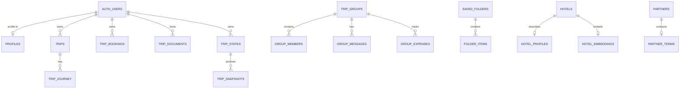

# Database Schema Reference

This page is a human-readable map of database entities. The executable schema
is in [schema.sql](../schema.sql) and [migrations/](../migrations/); consult
those files for exact column types, defaults, indexes, constraints, triggers,
functions, and policies. This document does not replace the DDL.

## Database topology

The application uses Supabase projects, not a generic PostgreSQL connection.
Supabase supplies PostgreSQL, Auth (`auth.users` and `auth.uid()`), PostgREST,
and row-level security integration. A process creates one database client from
one `SUPABASE_URL`.

The travel application and HostOS / StayOS are intended to use separate
projects. Do not apply a schema intended for one deployment to the other.
`schema.sql` contains the checked-in travel/core schema. The migration directory
contains additive and corrective changes for multiple product areas; it is not
a guarantee that every historical base table for both projects is recreated
from an empty database. In particular, `schema.sql` contains an older TripState
layout which is changed by the later TripDoc migrations. Read the migration
history before deciding what the current schema is.

## Entity relationships

The diagram shows the main declared relationships, not every foreign key or
application-level association. Some legacy traveller records deliberately use
text trip IDs, while TripState uses UUIDs; do not assume these are interchangeable.

## Core schema: `schema.sql`

### Identity and traveller trips

| Tables | Purpose |
| --- | --- |
| `profiles` | User profile, role, locale, preferences, and onboarding state; `id` references `auth.users`. |
| `trips` | Saved traveller trips, dates, budget, visibility, and itinerary JSON. |
| `internal_trip_logs` | Generated trip/itinerary records and public-feed source data. |
| `trip_journey` | Structured journey details associated with a saved trip. |
| `trip_bookings` | User-managed booking records and optional file references. |
| `trip_documents` | User trip documents and their storage metadata. |
| `user_home_feed` | Generated feed payloads associated with a user. |

### Groups and saved collections

| Tables | Purpose |
| --- | --- |
| `trip_groups` | Group identity, creator, trip association, and invite code. |
| `group_members` | Membership and group role. |
| `group_messages` | Group chat and poll payloads. |
| `group_expenses` | Shared expense entries and split information. |
| `saved_folders` | User-owned folders for saved content. |
| `folder_items` | Folder membership with an item snapshot. |

### Reels and video jobs

| Tables | Purpose |
| --- | --- |
| `reel_scans` | Analysis job, source URL, status, result, and completion data. |
| `reel_jobs` | User-visible job state, progress, and errors. |
| `saved_reels` | User-saved Reel content and metadata. |
| `trip_reels` | Reel/media attachments associated with a traveller trip. |
| `trip_saved_reels` | Links saved-library Reels to a trip. |

### TripState and assistant context

| Tables | Purpose |
| --- | --- |
| `trip_states` | Current TripDoc document, owner, visibility, status, and progress. |
| `user_travel_memory` | Per-user preference memory distilled from trip activity. |
| `trip_snapshots` | Bounded pre-regeneration TripDoc archives. |

The effective TripDoc row stores its JSON document in `trip_states.doc`.
`2026-07-16_trip_docs.sql` adds `doc` and `progress`; the later
`2026-07-16_drop_tripstate_tables.sql` removes the legacy event log, copilot
transcript, search-store tables, and old snapshot columns. Current writes are
whole-document updates, with `trip_snapshots` used for bounded
pre-regeneration archives. See [TripState removal plan](./tripstate_removal_plan.md).

## Recommendation schema

`migrations/2026-07-13_reco_engine.sql` enables `vector`, extends the existing
`hotels` table, and defines:

- `hotel_profiles` — semantic/personality tags and generated hotel copy.
- `hotel_embeddings` — 384-dimensional hotel vectors.
- `personality_centroids` — vector anchors for recommendation personas.
- `traveller_profiles` — per-user axes and embedding.
- `transport_options` — transport observations used for ranking/training.
- `rec_feedback` — impression and interaction signals.
- `ranking_weights` — persona/feature weights and variants.
- `expected_price` — price distributions by scope and key.
- `destination_priors` — destination-level persona, vibe, and vector priors.
- `match_hotels(...)` — vector-search RPC for hotel candidates.

The `hotels` master table is pre-existing and is augmented with slug, subscores,
landmarks, and canonical identity fields. The later TripState teardown removes
`trip_recommendations`; do not infer its current presence from the earlier
recommendation/search-store migration.

## Historical TripState and search-store tables

These tables are present in the earlier DDL and migrations, but the
`2026-07-16_drop_tripstate_tables.sql` migration records them as dropped after
the TripDoc cutover:

- `trip_state_events` and `copilot_messages`.
- `search_batches` and `search_results`.
- `trip_result_views`, `trip_recommendations`, and `trip_memory`.
- `trip_states.state`, `last_seq`, and `schema_version` columns.

The files `2026-07-13_reco_engine.sql` and `2026-07-14_search_store.sql` document
the earlier design and creation. The current trip-generation path stores
render-ready options in the TripDoc JSON instead. `transport_options` remains
the transport training/observation table. The forward-state details are in
[TripState removal plan](./tripstate_removal_plan.md).

## Marketplace, referral, and HostOS additions

Explicitly declared by checked-in migrations:

| Domain | Declared tables / changes |
| --- | --- |
| Group discovery | `group_trips` |
| Referrals and credits | `referral_codes`, `credit_ledger` |
| Trip snapshots | `trip_snapshots` |
| Partner commercial terms | `partner_terms`; also adds booking commission snapshots and coupon deal fields |
| Hotel rate and stay rules | `negotiation_rules`, `stay_time_rules`, `group_rate_tiers`, `group_policies` |
| Hotel services and content | `meal_options`, `experiences` |
| Hotel staff and operations | `hotel_team_members`, `team_notification_rules`, `agent_escalations`, `hotel_config_audit` |
| Hotel marketing | `marketing_profiles`, `ad_audiences`, `ad_campaigns`, `ad_creatives` |
| Agent/webhook controls | agent-tool grants and Razorpay webhook-event RLS/hardening changes |

HostOS application code also uses foundational tables such as `properties`,
`reservations`, `hotel_websites`, `partners`, `partner_members`, and `agents`.
These are not all created by the current `schema.sql`; verify the HostOS
project's actual schema and its setup history before bootstrapping a fresh
project. See [Deploying StayOS](../DEPLOYING_STAYOS.md).

## Functions, triggers, and access policies

The base schema declares `is_admin()`, `is_group_member(...)`,
`is_group_admin(...)`, and `handle_new_user()`. The auth trigger creates a
`profiles` row when a Supabase user signs up.

RLS patterns in the checked-in base schema and migrations include:

- User-owned rows are scoped by `auth.uid()`.
- Group data is scoped by membership/admin helper functions.
- Current TripDoc content is read by its owner or by callers when visibility is
  `link`/`public`; writes are performed through the backend.
- Recommendation entities expose selected public/profile read policies;
  writes are generally performed by the service role.
- Hotel property membership and role checks are also enforced in application
  dependencies; see [Security and tenancy](./security_and_tenancy.md).

The backend service-role key bypasses RLS. Route-level ownership, membership,
and permission checks therefore remain essential even when RLS is enabled.

## Schema change workflow

1. Identify the correct Supabase project and deployment mode.
2. Read the current schema and the entire migration being considered.
3. Check foreign keys, data backfills, indexes, RLS, and application callers.
4. Take an appropriate backup before destructive or data-rewriting changes.
5. Apply the migration to a non-production project first and verify the feature.
6. Record the migration and any deployment-specific requirements in
   [database_migrations.md](./database_migrations.md).

Do not treat filenames or this catalog as proof that a migration is safe to
replay against every project.
